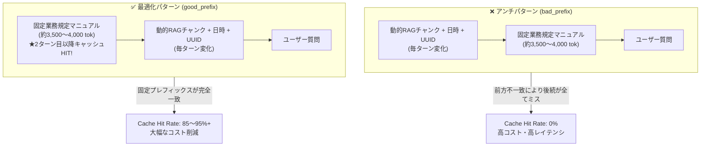

# RAG Prompt Caching Benchmark CLI (v2)

RAG（検索拡張生成）や業務チャットシステムにおいて、プロンプト内のコンテキスト配置順（固定文脈と動的文脈の前後関係）が **「プロンプトキャッシュ（Prefix Caching）のヒット率および利用コスト」** に与える影響を実測・可視化するPython製CLIベンチマークツールです。

主要LLMプロバイダ（**Anthropic Claude**, **OpenAI GPT**, **Google Gemini**）すべてに対応し、1コマンドでターミナルUI（`rich`）によるリアルタイム計測、生データCSVログ、および技術記事（Zenn / Qiita等）へそのまま転記可能なMarkdown比較レポートを自動生成します。

---

## 1. 背景と検証アーキテクチャ

主要LLMプロバイダのプロンプトキャッシュ機能はいずれも **「前方一致（Prefix Match）」** を前提としています。しかし、RAG検索チャンクや現在日時・セッションUUIDなどの動的変数をプロンプト先頭付近に差し込むと、後続の固定長文マニュアルやシステム指示が毎ターン連鎖的にキャッシュミスとなり、コスト削減メリットが完全に失われます。

本ツールでは、約3,500〜4,000トークンのダミー全社統合業務規定マニュアルを自動生成し、同一セッション内で以下の2パターンを実測比較します。



---

## 2. ディレクトリ構成

```text
rag-prompt-caching-benchmark/
├── pyproject.toml                  # プロジェクト設定・依存ライブラリ・Ruff/Pytest定義
├── requirements.txt                # 依存ライブラリ一覧
├── README.md                       # 概要、アーキテクチャ図、環境構築、実行コマンド
├── .env.example                    # APIキーおよびデフォルトモデル定義テンプレート
├── data/                           # 検証用インプットデータ（透明性・再現性確保）
│   ├── static_manual.md            # 固定コンテキスト（全社規定マニュアル 約3,500tok）
│   └── questions.json              # ターン別ユーザー質問定義リスト
├── results/                        # ベンチマーク出力先
│   └── latest/                     # ★ 常に最新1回分の実測レポート一式（Git追跡対象）
│       ├── comparison_report.md    # 3社横並び統合比較レポート
│       ├── report_anthropic.md     # Anthropic詳細レポート
│       ├── report_openai.md        # OpenAI詳細レポート
│       ├── report_gemini.md        # Gemini詳細レポート
│       └── *.csv                   # 各社ターン別生ログデータ
├── benchmark/
│   ├── __init__.py
│   ├── check_connection.py         # APIキー検証・疎通テストツール
│   ├── cli.py                      # CLI引数パーサー & 実行エントリポイント
│   ├── config.py                   # モデル別価格テーブル・環境変数ロード（ハードコード排除）
│   ├── core.py                     # ベンチマーク実行エンジン（ターン制御・動的RAG生成・集計）
│   ├── providers/                  # プロバイダ別アダプタ
│   │   ├── __init__.py
│   │   ├── base.py                 # 共通抽象基底クラス (BaseProvider)
│   │   ├── anthropic_provider.py   # Anthropic 実装 (cache_control: ephemeral)
│   │   ├── openai_provider.py      # OpenAI 実装 (自動Prefix Caching)
│   │   └── gemini_provider.py      # Google Gemini 実装 (google-genai / Context Caching)
│   └── reporters/                  # 出力フォーマッタ
│       ├── __init__.py
│       ├── console_reporter.py     # richライブラリを用いたターミナル描画
│       └── file_reporter.py        # CSV / Markdownレポート自動生成（latest自動同期）
└── tests/
    ├── test_benchmark.py           # モックを用いたトークン抽出・コスト計算・CLIの単体テスト
    └── test_connection.py          # 実APIへの疎通・認証テスト
```

---

## 3. 環境構築手順

### (1) 仮想環境の作成と依存パッケージのインストール

```bash
python3 -m venv .venv
source .venv/bin/activate
pip install -r requirements.txt
```

### (2) `.env` ファイルの作成と設定

`.env.example` をコピーして `.env` を作成し、使用するプロバイダのAPIキーとデフォルトモデルを設定してください。
（※コード内にモデル名のハードコードは行っておらず、`.env` または CLI引数 `--model` から動的に解決されます。）

```bash
cp .env.example .env
```

`.env` の設定例：

```env
# LLM API Keys
ANTHROPIC_API_KEY="your-anthropic-api-key-here"
OPENAI_API_KEY="your-openai-api-key-here"
GEMINI_API_KEY="your-gemini-api-key-here"

# Target Models (Default Settings)
# Anthropic: claude-sonnet-5-5 (または claude-opus-5-5 / claude-haiku-5-5)
DEFAULT_ANTHROPIC_MODEL="claude-sonnet-5-5"

# OpenAI: gpt-6.1-sol (または gpt-6-luna / gpt-6.1-terra / gpt-6-astra)
DEFAULT_OPENAI_MODEL="gpt-6.1-sol"

# Google: gemini-3.8-flash (または gemini-4-argon / gemini-3.1-pro / gemini-3.5-flash-lite)
DEFAULT_GEMINI_MODEL="gemini-3.8-flash"

# Benchmark Default Config
DEFAULT_TURNS=5
DEFAULT_DELAY_SECONDS=1.5
OUTPUT_DIR="./results"
```

---

## 4. 実行コマンド

### (1) API接続確認・認証テスト（疎通確認専用）

本番のベンチマーク実行前に、各プロバイダのAPIキー設定とエンドポイントへの通信確認を最小トークン（`max_tokens=1`）で行うことができます。

```bash
# 全プロバイダ（Anthropic, OpenAI, Gemini）を一括確認
python3 -m benchmark.check_connection

# 個別プロバイダのみ確認
python3 -m benchmark.check_connection --provider anthropic
python3 -m benchmark.check_connection --provider openai
python3 -m benchmark.check_connection --provider gemini

# pytest 経由で実行（.env にキーが未設定のプロバイダは自動スキップ）
pytest tests/test_connection.py -v
```

### (2) ベンチマーク実行コマンド

```bash
# 全3プロバイダを一括実行 & 横並び比較レポート（comparison_report_*.md）生成
python3 -m benchmark.cli --provider all --turns 5

# 基本実行 (Anthropic: .env の DEFAULT_ANTHROPIC_MODEL を使用)
python3 -m benchmark.cli --provider anthropic

# モデル明示指定・ターン数指定 (OpenAI)
python3 -m benchmark.cli --provider openai --model gpt-6.1-sol --turns 10

# Gemini デフォルト実行 (.env の gemini-3.8-flash を使用)
python3 -m benchmark.cli --provider gemini --turns 5

# Gemini Pro / Flash-Lite モデルの明示指定実行
python3 -m benchmark.cli --provider gemini --model gemini-3.1-pro --turns 5
python3 -m benchmark.cli --provider gemini --model gemini-3.5-flash-lite --turns 5
python3 -m benchmark.cli --provider gemini --model gemini-3.1-flash-lite --turns 5

# 出力先ディレクトリ指定・ターン間インターバル秒数調整
python3 -m benchmark.cli --provider anthropic --output-dir ./results --delay 2.0

# カスタムの固定マニュアルや質問ファイルを使用する場合
python3 -m benchmark.cli --provider gemini --manual-file ./data/static_manual.md --questions-file ./data/questions.json
```

---

## 5. 検証プロンプトの構成要素（インプットデータ設計）

GitHub公開時に読者が「何を入力してこの結果が出たのか」を完全にトレースできるよう、プロンプトを構成する3要素を明確に分離・可視化しています。

1. **固定コンテキスト（静的規定マニュアル）**:
   - 実体ファイル: [`data/static_manual.md`](./data/static_manual.md)（約3,500〜4,000トークン）
   - 全社統合情報セキュリティ・クラウド運用・AIガバナンス業務規定（全10章）。
   - 各社プロバイダのキャッシュ発動閾値（1,024〜2,048トークン）を安定して超えるベースラインテキストです。
2. **動的コンテキスト（毎ターン変化するRAGチャンク）**:
   - 各ターンの実行時にプログラム（`benchmark/core.py` の `build_dynamic_rag_chunk`）が生成するリアルタイム検索結果。
   - ターンごとに異なる **セッションUUID4**、**UTCタイムスタンプ**、**検索スコア** が含まれます。
   - 先頭に配置されると後続の固定マニュアルをすべてキャッシュミスさせます（`bad_prefix`）。
3. **ユーザー質問**:
   - 実体ファイル: [`data/questions.json`](./data/questions.json)
   - 規定マニュアルの内容（MFA要件、バックアップ保持期間、インシデントエスカレーション等）を問う質問リストです。

### プロンプト組み立てレイアウト比較

| パターン | プロンプト組み立て順序 | キャッシュの挙動とメカニズム |
| :--- | :--- | :--- |
| **`bad_prefix`**<br/>(アンチパターン) | `[動的RAGチャンク (UUID/時刻)]`<br/>＋ `[固定業務規定 (data/static_manual.md)]`<br/>＋ `[質問 (data/questions.json)]` | 先頭のUUID・時刻が毎ターン異なるため、**前方一致条件が破綻**。後続の約3,500トークンが毎ターン新規課金（キャッシュミス）される。 |
| **`good_prefix`**<br/>(最適化パターン) | `[固定業務規定 (data/static_manual.md)]`<br/>＋ `[動的RAGチャンク (UUID/時刻)]`<br/>＋ `[質問 (data/questions.json)]` | 先頭の約3,500トークンが毎ターン完全一致。**2ターン目以降に85〜95%+のキャッシュヒット**を達成しコスト激減。 |

---

## 6. 対応プロバイダ・モデル価格テーブル（USD / 1M tokens）

`benchmark/config.py` の `MODEL_PRICING_TABLE` にて以下のモデルをサポートしています。日付付きスナップショット名（例: `claude-sonnet-4-5-20250929`, `gpt-4.1-2025-04-14`）もプレフィックス一致により自動解決されます。

> [!IMPORTANT]
> **【料金単価に関する重要なご注意】**
> 下表および `benchmark/config.py` に記載されている各モデルのトークン単価（USD / 1M tokens）は、すべて **2026年10月28日時点の公式調査レポート** の情報に基づく最新設定です（Anthropic Claude 5/5.5系、OpenAI GPT-6系、Google Gemini 3/4系に対応）。
> 旧世代モデル（Claude 3.5 Sonnet、GPT-4o、GPT-4.1系、Gemini 2.5系など）は各社で退役（Retired）または非推奨（Deprecated/提供終了予定）宣告が進んでいるため、ベンチマークのデフォルトには現行の推奨最新モデルを設定しています。正確な最新仕様や追加オプション料金（12時間キャッシュ保持、Gemini時間ストレージ課金等）については、各社公式の料金ページをご確認ください。

| プロバイダ | モデルID (推奨現行モデル) | 通常入力 | キャッシュ書込 | キャッシュ読取 (Hit) | 出力 | キャッシュ方式 / 仕様概要 (2026/10/28基準) |
| :--- | :--- | ---: | ---: | ---: | ---: | :--- |
| **Anthropic** | `claude-fable-5-1` | \$10.00 | \$12.50 | \$0.25 | \$50.00 | 明示的ブロック指定 (Hit: 0.025x / 97.5%引) |
| **Anthropic** | `claude-opus-5-5` | \$4.00 | \$5.00 | \$0.20 | \$20.00 | 明示的ブロック指定 (Hit: 0.05x / 95%引) |
| **Anthropic** | `claude-sonnet-5-5` (デフォルト) | \$2.00 | \$2.50 | \$0.10 | \$10.00 | 明示的ブロック指定 (Hit: 0.05x / 95%引) |
| **Anthropic** | `claude-sonnet-5` | \$2.00 | \$2.50 | \$0.20 | \$10.00 | 明示的ブロック指定 (Hit: 0.10x / 90%引) |
| **Anthropic** | `claude-haiku-5-5` | \$0.10 | \$0.125 | \$0.01 | \$0.50 | 明示的ブロック指定 (≤100k時、Hit: 90%引) |
| **Anthropic** | `claude-sonnet-4-6` | \$3.00 | \$3.75 | \$0.30 | \$15.00 | 明示的ブロック指定 (Hit: 0.10x / 90%引) |
| **OpenAI** | `gpt-6-astra` | \$10.00 | \$12.50 | \$1.00 | \$50.00 | Responses API (30分TTL: 1.25x, Hit: 90%引) |
| **OpenAI** | `gpt-6.1-sol` (デフォルト) | \$2.00 | \$2.50 | \$0.10 | \$10.00 | Responses API (30分TTL: 1.25x, Hit: 95%引) |
| **OpenAI** | `gpt-6.1-terra` | \$1.00 | \$1.25 | \$0.05 | \$5.00 | Responses API (30分TTL: 1.25x, Hit: 95%引) |
| **OpenAI** | `gpt-6-luna` | \$0.10 | \$0.125 | \$0.01 | \$0.50 | Responses API (30分TTL: 1.25x, Hit: 90%引) |
| **Google** | `gemini-4-argon` | \$2.00 | \$0.00 | \$0.10 | \$10.00 | 暗黙キャッシュ (プロモーションレート適用中) |
| **Google** | `gemini-3.8-flash` (デフォルト) | \$0.75 | \$0.00 | \$0.075 | \$3.75 | Context Caching (明示/暗黙 + 保管料$0.50/M tok/hr) |
| **Google** | `gemini-3.6-flash` | \$0.75 | \$0.00 | \$0.075 | \$3.75 | Context Caching (明示/暗黙 + 保管料$0.50/M tok/hr) |
| **Google** | `gemini-3.1-pro-preview` | \$2.00 | \$0.00 | \$0.20 | \$12.00 | Context Caching (≤200k時、Hit: 90%引) |
| **Google** | `gemini-3.5-flash-lite` | \$0.30 | \$0.00 | \$0.03 | \$2.50 | Context Caching (明示/暗黙) |
| **Google** | `gemini-3.1-flash-lite` | \$0.25 | \$0.00 | \$0.025 | \$1.50 | Context Caching (明示/暗黙) |

---

## 7. レイテンシ（応答時間）の計測方法と解釈の前提

本ツールでは、各ターンの応答時間（`latency_seconds`）を記録していますが、プロンプトキャッシュにおけるレイテンシを評価・分析する際は以下の前提知識が重要です。

### (1) 計測境界と手法の厳密性
- **同一高精度タイマーの使用**: 全プロバイダ（Anthropic / OpenAI / Gemini）共通で、OS依存のない最高分解能タイマー `time.perf_counter()` を使用しています。
- **計測対象**: 各社公式SDKによる同期HTTPリクエスト呼び出し直前から、サーバーが推論を完了してHTTPレスポンス全体を受信・デシリアライズし終えるまでの **純粋なAPIターンアラウンド往復時間（RTT + サーバー推論時間）** を計測しています（クライアント側の事前・事後処理時間は含みません）。

### (2) キャッシュヒットによるレイテンシ短縮のメカニズム
- **Prefill（入力プロンプト処理）の計算スキップ**:
  LLMはテキスト生成（Decode）を開始する前に、入力プロンプト全体のアテンション計算（Prefill）を行います。固定コンテキスト（約3,500トークン）がキャッシュHIT（`good_prefix`）した場合、この大規模なPrefill計算がサーバー側KVキャッシュの再利用によってスキップされるため、**TTFT（Time-To-First-Token）および総レイテンシが大幅に短縮** されます。

### (3) プロバイダ間での「絶対値レイテンシ比較」における注意点
- **他社との秒数差ではなく「自社内の改善比率」を見る**:
  APIサーバーの物理的な配置リージョン（米東海岸 vs 米西海岸 vs 日本国内など）、モデル自体のパラメータ規模（巨大Denseモデル vs 軽量MoEモデル）、および各社の同時接続混雑度によって、ベースラインのネットワークRTTは大きく異なります。
- したがって、ベンチマークにおける最も科学的で妥当なレイテンシ評価指標は、プロバイダ間の絶対秒数比較ではなく、**「同一プロバイダ内における bad_prefix（ミス時）と good_prefix（ヒット時）のレイテンシ短縮率（例: 3.5秒 → 1.2秒で約65%改善）」** です。

---

## 8. テストおよび静的解析（Linter）の実行

モックを用いた単体テスト（`pytest`）および `ruff` によるコード品質チェックを以下のコマンドで実行できます。

```bash
# ユニットテストの実行
.venv/bin/pytest -v

# Ruff による静的解析チェック
.venv/bin/ruff check .
```
