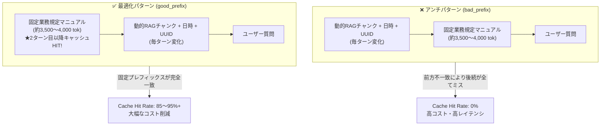

# RAG Prompt Caching Benchmark CLI (v2)

RAG（検索拡張生成）や業務チャットシステムにおいて、プロンプト内のコンテキスト配置順（固定文脈と動的文脈の前後関係）が **「プロンプトキャッシュ（Prefix Caching）のヒット率および利用コスト」** に与える影響を実測・可視化するPython製CLIベンチマークツールです。

主要LLMプロバイダ（**Anthropic Claude**, **OpenAI GPT**, **Google Gemini**）すべてに対応し、1コマンドでターミナルUI（`rich`）によるリアルタイム計測、生データCSVログ、および技術記事（Zenn / Qiita等）へそのまま転記可能なMarkdown比較レポートを自動生成します。

---

## 1. 背景と検証アーキテクチャ

主要LLMプロバイダのプロンプトキャッシュ機能はいずれも **「前方一致（Prefix Match）」** を前提としています。しかし、RAG検索チャンクや現在日時・セッションUUIDなどの動的変数をプロンプト先頭付近に差し込むと、後続の固定長文マニュアルやシステム指示が毎ターン連鎖的にキャッシュミスとなり、コスト削減メリットが完全に失われます。

本ツールでは、約3,500〜4,000トークンのダミー全社統合業務規定マニュアルを自動生成し、同一セッション内で以下の2パターンを実測比較します。



---

## 2. ディレクトリ構成

```text
rag-prompt-caching-benchmark/
├── pyproject.toml                  # プロジェクト設定・依存ライブラリ・Ruff/Pytest定義
├── requirements.txt                # 依存ライブラリ一覧
├── README.md                       # 概要、アーキテクチャ図、環境構築、実行コマンド
├── .env.example                    # APIキーおよびデフォルトモデル定義テンプレート
├── data/                           # 検証用インプットデータ（透明性・再現性確保）
│   ├── static_manual.md            # 固定コンテキスト（全社規定マニュアル 約3,500tok）
│   └── questions.json              # ターン別ユーザー質問定義リスト
├── benchmark/
│   ├── __init__.py
│   ├── check_connection.py         # APIキー検証・疎通テストツール
│   ├── cli.py                      # CLI引数パーサー & 実行エントリポイント
│   ├── config.py                   # モデル別価格テーブル・環境変数ロード（ハードコード排除）
│   ├── core.py                     # ベンチマーク実行エンジン（ターン制御・動的RAG生成・集計）
│   ├── providers/                  # プロバイダ別アダプタ
│   │   ├── __init__.py
│   │   ├── base.py                 # 共通抽象基底クラス (BaseProvider)
│   │   ├── anthropic_provider.py   # Anthropic 実装 (cache_control: ephemeral)
│   │   ├── openai_provider.py      # OpenAI 実装 (自動Prefix Caching)
│   │   └── gemini_provider.py      # Google Gemini 実装 (google-genai / Context Caching)
│   └── reporters/                  # 出力フォーマッタ
│       ├── __init__.py
│       ├── console_reporter.py     # richライブラリを用いたターミナル描画
│       └── file_reporter.py        # CSV / Markdownレポート自動生成
└── tests/
    ├── test_benchmark.py           # モックを用いたトークン抽出・コスト計算・CLIの単体テスト
    └── test_connection.py          # 実APIへの疎通・認証テスト
```

---

## 3. 環境構築手順

### (1) 仮想環境の作成と依存パッケージのインストール

```bash
python3 -m venv .venv
source .venv/bin/activate
pip install -r requirements.txt
```

### (2) `.env` ファイルの作成と設定

`.env.example` をコピーして `.env` を作成し、使用するプロバイダのAPIキーとデフォルトモデルを設定してください。
（※コード内にモデル名のハードコードは行っておらず、`.env` または CLI引数 `--model` から動的に解決されます。）

```bash
cp .env.example .env
```

`.env` の設定例：

```env
# LLM API Keys
ANTHROPIC_API_KEY="your-anthropic-api-key-here"
OPENAI_API_KEY="your-openai-api-key-here"
GEMINI_API_KEY="your-gemini-api-key-here"

# Target Models (Default Settings)
# Anthropic: claude-sonnet-4-5 (または claude-sonnet-5-5 / claude-haiku-4-5)
DEFAULT_ANTHROPIC_MODEL="claude-sonnet-4-5"

# OpenAI: gpt-4.1 (または gpt-5 / gpt-4.1-mini / gpt-4o / gpt-4o-mini)
DEFAULT_OPENAI_MODEL="gpt-4.1"

# Google: gemini-3.8-flash (または gemini-3.1-pro / gemini-3.1-pro-preview / gemini-3.5-flash-lite / gemini-3.1-flash-lite)
DEFAULT_GEMINI_MODEL="gemini-3.8-flash"

# Benchmark Default Config
DEFAULT_TURNS=5
DEFAULT_DELAY_SECONDS=1.5
OUTPUT_DIR="./results"
```

---

## 4. 実行コマンド

### (1) API接続確認・認証テスト（疎通確認専用）

本番のベンチマーク実行前に、各プロバイダのAPIキー設定とエンドポイントへの通信確認を最小トークン（`max_tokens=1`）で行うことができます。

```bash
# 全プロバイダ（Anthropic, OpenAI, Gemini）を一括確認
python3 -m benchmark.check_connection

# 個別プロバイダのみ確認
python3 -m benchmark.check_connection --provider anthropic
python3 -m benchmark.check_connection --provider openai
python3 -m benchmark.check_connection --provider gemini

# pytest 経由で実行（.env にキーが未設定のプロバイダは自動スキップ）
pytest tests/test_connection.py -v
```

### (2) ベンチマーク実行コマンド
python3 -m benchmark.cli --provider anthropic

# モデル明示指定・ターン数指定 (OpenAI)
python3 -m benchmark.cli --provider openai --model gpt-4.1 --turns 10

# Gemini デフォルト実行 (.env の gemini-3.8-flash を使用)
python3 -m benchmark.cli --provider gemini --turns 5

# Gemini Pro / Flash-Lite モデルの明示指定実行
python3 -m benchmark.cli --provider gemini --model gemini-3.1-pro --turns 5
python3 -m benchmark.cli --provider gemini --model gemini-3.5-flash-lite --turns 5
python3 -m benchmark.cli --provider gemini --model gemini-3.1-flash-lite --turns 5

# 出力先ディレクトリ指定・ターン間インターバル秒数調整
python3 -m benchmark.cli --provider anthropic --output-dir ./results --delay 2.0

# カスタムの固定マニュアルや質問ファイルを使用する場合
python3 -m benchmark.cli --provider gemini --manual-file ./data/static_manual.md --questions-file ./data/questions.json
```

---

## 5. 検証プロンプトの構成要素（インプットデータ設計）

GitHub公開時に読者が「何を入力してこの結果が出たのか」を完全にトレースできるよう、プロンプトを構成する3要素を明確に分離・可視化しています。

1. **固定コンテキスト（静的規定マニュアル）**:
   - 実体ファイル: [`data/static_manual.md`](./data/static_manual.md)（約3,500〜4,000トークン）
   - 全社統合情報セキュリティ・クラウド運用・AIガバナンス業務規定（全10章）。
   - 各社プロバイダのキャッシュ発動閾値（1,024〜2,048トークン）を安定して超えるベースラインテキストです。
2. **動的コンテキスト（毎ターン変化するRAGチャンク）**:
   - 各ターンの実行時にプログラム（`benchmark/core.py` の `build_dynamic_rag_chunk`）が生成するリアルタイム検索結果。
   - ターンごとに異なる **セッションUUID4**、**UTCタイムスタンプ**、**検索スコア** が含まれます。
   - 先頭に配置されると後続の固定マニュアルをすべてキャッシュミスさせます（`bad_prefix`）。
3. **ユーザー質問**:
   - 実体ファイル: [`data/questions.json`](./data/questions.json)
   - 規定マニュアルの内容（MFA要件、バックアップ保持期間、インシデントエスカレーション等）を問う質問リストです。

### プロンプト組み立てレイアウト比較

| パターン | プロンプト組み立て順序 | キャッシュの挙動とメカニズム |
| :--- | :--- | :--- |
| **`bad_prefix`**<br/>(アンチパターン) | `[動的RAGチャンク (UUID/時刻)]`<br/>＋ `[固定業務規定 (data/static_manual.md)]`<br/>＋ `[質問 (data/questions.json)]` | 先頭のUUID・時刻が毎ターン異なるため、**前方一致条件が破綻**。後続の約3,500トークンが毎ターン新規課金（キャッシュミス）される。 |
| **`good_prefix`**<br/>(最適化パターン) | `[固定業務規定 (data/static_manual.md)]`<br/>＋ `[動的RAGチャンク (UUID/時刻)]`<br/>＋ `[質問 (data/questions.json)]` | 先頭の約3,500トークンが毎ターン完全一致。**2ターン目以降に85〜95%+のキャッシュヒット**を達成しコスト激減。 |

---

## 6. 対応プロバイダ・モデル価格テーブル（USD / 1M tokens）

`benchmark/config.py` の `MODEL_PRICING_TABLE` にて以下のモデルをサポートしています。日付付きスナップショット名（例: `claude-sonnet-4-5-20250929`, `gpt-4.1-2025-04-14`）もプレフィックス一致により自動解決されます。

> [!IMPORTANT]
> **【料金単価に関する重要なご注意】**
> 下表および `benchmark/config.py` に記載されている各モデルのトークン単価（USD / 1M tokens）は、すべて **2026年10月27日時点** の情報に基づく参考値（プロモーション価格・プレビュー価格等を含む）です。
> 各LLMプロバイダの価格改定やモデルのライフサイクル変更が頻繁に行われるため、**正確な最新料金については必ず各社公式の料金ページ（Anthropic / OpenAI / Google AI for Developers）をご自身で確認の上、必要に応じて `benchmark/config.py` の `MODEL_PRICING_TABLE` を更新してご利用ください。**

| プロバイダ | モデルID | 通常入力 | キャッシュ書込 | キャッシュ読取 (Hit) | 出力 | キャッシュ方式 |
| :--- | :--- | ---: | ---: | ---: | ---: | :--- |
| **Anthropic** | `claude-sonnet-4-5` / `claude-sonnet-4-6` | \$3.00 | \$3.75 | \$0.30 | \$15.00 | 明示的ブロック指定 (`ephemeral`) |
| **Anthropic** | `claude-sonnet-5-5` | \$2.00 | \$2.50 | \$0.10 | \$10.00 | 明示的ブロック指定 (`ephemeral`) |
| **Anthropic** | `claude-haiku-4-5` / `claude-haiku-5-5` | \$1.00 | \$1.25 | \$0.10 | \$5.00 | 明示的ブロック指定 (`ephemeral`) |
| **Anthropic** | `claude-3-5-sonnet-latest` | \$3.00 | \$3.75 | \$0.30 | \$15.00 | 明示的ブロック指定 (`ephemeral`) |
| **OpenAI** | `gpt-4.1` | \$2.00 | \$0.00 | \$0.50 | \$8.00 | 自動Prefix Caching |
| **OpenAI** | `gpt-4.1-mini` | \$0.40 | \$0.00 | \$0.10 | \$1.60 | 自動Prefix Caching |
| **OpenAI** | `gpt-5` | \$1.25 | \$0.00 | \$0.125 | \$10.00 | 自動Prefix Caching |
| **OpenAI** | `gpt-5-mini` | \$0.25 | \$0.00 | \$0.025 | \$1.00 | 自動Prefix Caching |
| **OpenAI** | `gpt-4o` | \$2.50 | \$0.00 | \$1.25 | \$10.00 | 自動Prefix Caching |
| **OpenAI** | `gpt-4o-mini` | \$0.15 | \$0.00 | \$0.075 | \$0.60 | 自動Prefix Caching |
| **Google** | `gemini-3.8-flash` (デフォルト) | \$0.75 | \$0.00 | \$0.075 | \$3.75 | Context Caching (Explicit / Implicit) |
| **Google** | `gemini-3.1-pro` / `gemini-3.1-pro-preview` | \$2.00 | \$0.00 | \$0.20 | \$12.00 | Context Caching (Explicit / Implicit) |
| **Google** | `gemini-3.5-flash-lite` | \$0.30 | \$0.00 | \$0.03 | \$2.50 | Context Caching (Explicit / Implicit) |
| **Google** | `gemini-3.1-flash-lite` | \$0.25 | \$0.00 | \$0.025 | \$1.50 | Context Caching (Explicit / Implicit) |
| **Google** | `gemini-2.5-flash` | \$0.30 | \$0.00 | \$0.03 | \$2.50 | Context Caching (Explicit / Implicit) |
| **Google** | `gemini-2.5-pro` | \$1.25 | \$0.00 | \$0.125 | \$10.00 | Context Caching (Explicit / Implicit) |
| **Google** | `gemini-2.5-flash-lite` | \$0.10 | \$0.00 | \$0.01 | \$0.40 | Context Caching (Explicit / Implicit) |

---

## 7. テストおよび静的解析（Linter）の実行

モックを用いた単体テスト（`pytest`）および `ruff` によるコード品質チェックを以下のコマンドで実行できます。

```bash
# ユニットテストの実行
.venv/bin/pytest -v

# Ruff による静的解析チェック
.venv/bin/ruff check .
```
